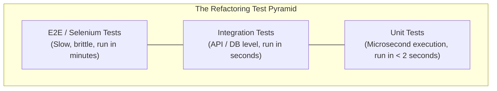
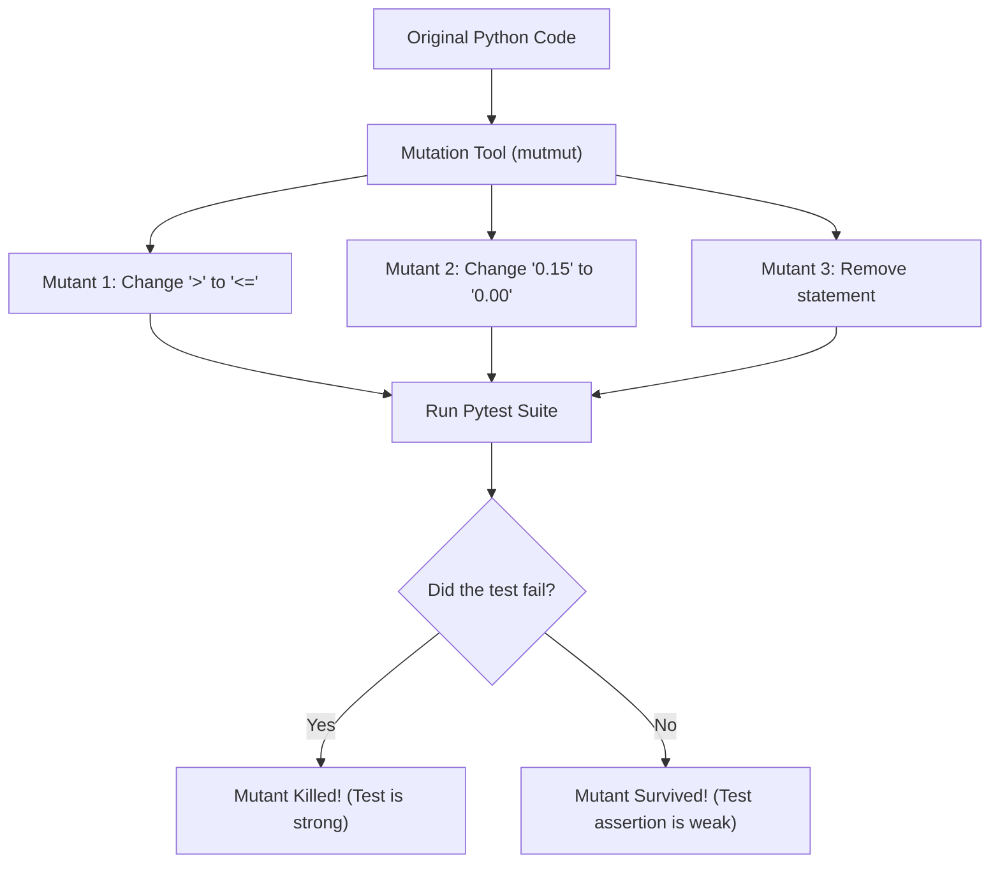

# Regression Testing & The Test Pyramid 🔁

## Source Reference
* **Authors:** Martin Fowler (*Practical Test Pyramid*), Alexander Shvets (*Dive Into Refactoring*)
* **Core Philosophy:** A regression suite must provide rapid, trustworthy feedback to give developers the courage to refactor boldly.

---

## 1. The Refactoring Test Pyramid

A common mistake in legacy enterprise systems is relying heavily on slow end-to-end (E2E) UI or browser tests for regression protection.



### Why Unit Tests Dominate Refactoring:
* **Speed:** 500 unit tests run in under 2 seconds. A developer can execute them after every single atomic method extraction.
* **Pinpoint Accuracy:** When an E2E test fails, you only know that "the checkout page broke." When a unit test fails, it points to the exact line in `calculate_tax()`.
* **Determinism:** Unit tests do not suffer from network timeouts, browser flakiness, or database connection pool exhaustion.

---

## 2. Test Coverage vs. Test Quality

> [!WARNING]
> **The 100% Coverage Illusion:** High code coverage (e.g. 95% via `pytest-cov`) does **not** mean your refactoring is safe. It only means those lines were executed by the Python interpreter during the test run; it does not guarantee that your assertions actually validated correctness.

### Example of Deceptive 100% Coverage:
```python
# Function under test
def calculate_rebate(total: float) -> float:
  if total > 1000.0:
    return total * 0.15
  return 0.0


# Useless test with 100% line coverage
def test_calculate_rebate():
  calculate_rebate(1500.0)  # Executes both lines!
  # But zero assertions were made! If you change 0.15 to 0.00, this test still passes!
```

---

## 3. Mutation Testing in Python (`mutmut`)

To know whether your test suite is strong enough to support aggressive refactoring, use **Mutation Testing**.



### The Mutation Score:
$$\text{Mutation Score} = \frac{\text{Mutants Killed}}{\text{Total Mutants Generated}} \times 100\%$$

If a mutant mutates `>` to `<` in your business logic and all your tests still pass, **your test suite has a blind spot**. You must strengthen the assertions before beginning refactoring.

---

## 4. Key Takeaways

1. **Optimize for test speed:** Keep the core refactoring test suite running in under 5 seconds.
2. **Push tests down the pyramid:** Replace slow database-backed integration tests with fast, isolated unit tests.
3. **Assert boundaries strictly:** Verify edge cases with explicit inputs rather than broad exploratory checks.
